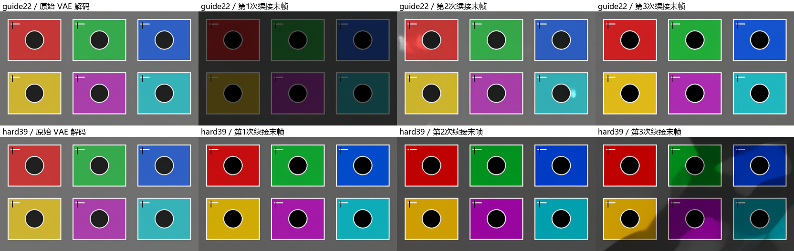

# H3 上下文接缝的构图漂移

对照流：[H3测试流-传统二采极速-前缀保护对照](../examples/H3测试流-传统二采极速-前缀保护对照.json)。它复制自调度优化流，使用独立的视频与两路 Latent 目录，从循环序号 0 开始运行。

## 全模态上下文对照流

[H3测试流-传统二采极速-全模态上下文](../examples/H3测试流-传统二采极速-全模态上下文.json) 复制自调度优化流，使用当前【H3 全模态生成】的 VIDEO 上下文方式：上一段最终视频尾部 22 帧，前 21 帧加 0.1 噪声、最后一帧保持原样；两次采样各接原生 Add Guide 和 256 ticks 音频羽化。解码、修脸并同步裁去 22 帧音视频后，以上一段末帧为参考，使用 `mkl_lab`、首帧统计、强度 0.75 统一匹配整段颜色。

循环直接传递包含修脸、裁剪和颜色匹配结果的最终 VIDEO。首段通过惰性分支跳过视频尾部读取、上下文引导和颜色匹配。默认从序号 0 连续运行两段，延长测试时修改循环停止值。首采 4 步 Euler、传统放大、二采 2 步 SA Solver、LoRA、Sigma、分辨率及 TE 调度沿用原流。每段保存最终视频后进入下一轮。

布局按 PGS 参考流整理为上方上下文循环、中间从左到右的生成主链、下方参考素材与提示词。主画布共 20 个节点；上下文准备、尺寸计算、参考编码、传统二采、小脸修复和裁切调色使用 ComfyUI 原生子图，双击即可展开并替换内部节点。

【参考素材集合】的图片入口连接后自动增加。按入口顺序编号为 `<Picture N>`，用途由提示词描述，不固定人物和场景槽位；不需要的图可断开，需要更多图可复制图片加载器并连接新入口。全部图片均可留空。首采、二采、小脸修复和 PGS 提示词别名转换共用这一集合，避免增删图片时漏接某一次采样。增删后应检查提示词中的编号。修脸人数是要处理的检测目标数量，独立于参考图数量。

提示词输入 `@` 可选择集合中的图片、源视频与音轨，并查看图片预览。直接连接的图片自动命名为 `Picture_1`、`Picture_2` 等。需要自定义名称时，把图片接入原生 PGS 图片标记节点，填写 alias 和 label；多个标记通过 `previous` 串联，最后一个标记的 `schedule` 接集合的【PGS 图片标记】。标记链同时携带真实图片，无需再把同一张图重复接到集合的图片入口。标记图片排在前面，直接接入集合的图片顺延编号；素材集合的输出仍共用给提示词、一采、二采和修脸。改名或增删图片后编辑器自动更新候选，也可点【刷新】立即更新。

本次同步修改了已安装的 `ComfyUI-MiniMaxH3-Ref-PGS`：前端识别集合，图片标记输出保留真实图片。对应改动保存于 [PGS 集成补丁](../patches/minimax-h3-ref-pgs-reference-assets.patch)。需要重启 ComfyUI 并刷新页面，才能同时加载两边的更新。

分辨率下方的【首采比例】控制宽高缩放，默认 0.5，可改为 0.33、0.6、0.75 等数值。首采宽高按 32 对齐；二采参考与放大的目标尺寸始终由最终分辨率控件决定。0.5 表示首采宽高各减半，像素面积约为最终的四分之一。

【05 传统放大与二采】外露放大模型、FFN 分块、种子、采样器与 Sigma；【06 视频解码与小脸修复】外露修脸开关、人数、Sigma 与反向处理。最终分辨率控件与图片、视频预览仍保留在主画布。

副本同步至本机 ComfyUI 工作流目录。新增的素材集合与参考编码节点需要重启 ComfyUI 加载，然后刷新页面并重新打开工作流。除参考集合和首采尺寸计算的预期变化外，执行输入与原始配方逐项比对；保留原采样器、Sigma、LoRA、TE 调度和上下文方式。

验证覆盖原生前端重新载入后动态连接 0、1、3、12 张图，外部首采比例 0.33、0.6、0.75、1 的传递，以及 CPU 下官方参考编码、多人修脸展开、空素材、子图连线和三轮实际 VIDEO 传递。未重新运行完整 GPU 双采生成。

## 定位结果

2026-11-01 用户运行的调度优化流，两段输出均为 1920×1088，首采均为 960×544；参考视频使用保持比例缩放，两路上下文 Latent 的空间尺寸也各自相同。

直接比较第一段末帧和第二段首帧，静态背景约有横向放大 0.6%、纵向缩小 0.3% 的变化。解码已保存的两路 Latent 后，一采结果中已存在该变化；二采前就出现了构图漂移。原参考视频对应的相邻帧没有同量级的缩放。

更关键的对照是：第一段第 174 帧与第二段尚未裁剪的第 21 帧代表同一个重叠时刻，仍有约 0.56% 的横向缩放；而第二段内部第 21 → 22 帧的背景缩放约为 0.01%。这说明重叠区已被重新生成，裁掉 22 帧后直接切入它，暴露出两段之间的几何差异。

原流的 #581、#611 使用 `guide`，将前段 Latent 尾部作为条件参考，不保护目标采样 Latent 的前缀。#604、#579 JoinMatch 校正通道的亮度、对比度与细节，不能锁定空间几何；#562 负责裁掉重叠帧。颜色接近不代表构图逐像素相同。

以上缩放来自静态背景 SIFT 特征匹配与 RANSAC 仿射拟合，排除了人物所在的中央区域，是接缝附近的近似测量。

## 对照流接法

- #581 改为 `masked_av`，首采继续接它的 `latent` 输出。
- #611 改为 `masked_av`，输入改接传统放大后的 #608 AV Latent；二采 #617 改接 #611 的 `latent` 输出，使前缀与 `noise_mask` 一起进入二采。
- #622 的高分编码等待信号改接 #609 参考编码，避免“二采前缀保护等待首采，首采又等待二采前缀保护”的循环依赖。
- 保留原 LoRA、4+2 采样、Sigma、放大器、JoinMatch、修脸和最终分辨率。

当前安装的 PGS `masked_av` 实现为前缀加入 0.02 噪声、使用 0.15 软掩码，音视频共同保护 22 帧；它仍允许少量变化，不是逐像素硬锁。

## 验证

复用用户已生成的第一段高、低分辨率 Latent，只重跑第二段。先检查一采，确认缩放偏差减小后，再复用该一采缓存运行二采和修脸。

一采的横向缩放偏差由约 0.76% 降至 0.14%，纵向绝对偏差由约 0.24% 降至 0.09%。4 步一采约 78 秒，未继续测试其他采样配置。

二采与修脸全部完成后，最终接缝的横向偏差由约 0.63% 降至 0.086%，纵向绝对偏差由约 0.30% 降至 0.066%。背景的近似水平偏移由 6.9 像素降至 1.1 像素。输出仍为 1920×1088、24 fps、153 帧；已检查首、中、尾帧。两次请求分别约 151 秒和 177 秒，后一次复用一采缓存。

这是一份素材第二段的单次对照，使用的是现有 PGS 软保护实现，不能保证其他素材或更长接续完全没有形变。没有替换三个全模态生成节点的上下文实现。测量与输出位置见 [本机接缝测量](H3_CONTEXT_SEAM_MEASUREMENT.json)。

工作流结构测试检查了两路掩码接入、编码等待无环、前端连线记录一致性，以及不同分辨率的独立读写目录。

## 480p 控制实验：接缝对齐是否造成拉伸

2026-11-01 追加实际 GPU 测试，先用 832×480 六色块、圆形和直线隔离 VAE 与采样，再用用户原素材复验。原素材保留 Dasiwa Hybrid V4 INT8、DMAD 与人物替换 LoRA、4 步 Euler/simple、12/2 Sigma Shift 和原参考素材，仅将首采改为 832×480，省略二采、修脸。每种上下文只采样一次；关闭 JoinMatch、完整 JoinMatch、仅均值 JoinMatch 共用该次采样结果。

比较第一段末帧与第二段裁掉重叠后的第一帧，静态背景 SIFT/RANSAC 的近似横向缩放如下：

| 上下文 | 关闭接缝对齐 | 完整接缝对齐 |
| --- | ---: | ---: |
| PGS guide，22 帧 | +0.473% | +0.466% |
| PGS masked_av，22 帧 | +0.118% | +0.127% |
| Generated AV Masked Context，39 帧严格保护 | +0.046% | +0.036% |

直接比较对齐前后同一张首帧，JoinMatch 增加的横向缩放分别约为 −0.0008%、+0.0026%、−0.0018%；它不是这次约 0.47% 横向漂移的主要来源。`guide` 的重叠区末帧在进入 JoinMatch 之前已经有 +0.451% 横向变化，说明同一历史画面已在采样中被重新生成。严格保护的 Latent 前缀与上一段尾部完全一致，但新生成区仍可能变化，不能承诺逐帧几何或颜色完全不变。

JoinMatch 确实会改变整段，包括已保护的前缀。22 帧配置中，它把上一段最后一个 Latent token 与本段第 11 个 token（从 0 计数，覆盖约第 35 帧起）比较，随后对整段应用通道均值、可选对比度和细节修正。这两个 token 同相位，但不是同一重叠时刻。本组实际仅触发均值修正，完整对齐与仅均值结果相同；`guide` 首帧的背景亮度差由约 −2.65 降至 −0.60（CIELAB L*）。关闭它没有消除拉伸，且该素材的亮度接缝增大。因此不能仅凭节点名称认定它是拉伸主因，也不应把它的全段修正当成几何锁定。

严格保护的 39 帧测试同步将源视频分段步长从 153 改为 136（175−39），第二段源素材从第 136 帧开始。若只改上下文为 39、仍按 22 帧安排源素材，会引入新的时间错位。

VAE 控制中，同一段尾部 Latent 单独解码的最后一帧，与原完整解码末帧逐像素相同。将它放入另一个有不同后续内容的完整 Latent 后，重叠末帧会受时序解码邻域影响，仍有少量差异。采样器 `output` 与 `denoised_output` 的视频差最大约 4.8e−7（本组 Euler 到 0），没有发现选错输出导致前缀失效。

色块实验未加入人物替换 LoRA，也未经过二采、修脸或 JoinMatch：PGS guide 和原生 Add Guide 都复现了尾部显著变暗，单纯把 22 帧增到 39 帧没有改善。严格保护的首轮避免了同等级变暗，但继续续接三次后，灰背景均值仍从原约 112 降到约 51；guide 则先暗后亮，未呈现单调累积。两种方法都不能保证新区域的亮度和色彩稳定。这是当前模型、加速 LoRA、Sigma 与色块素材组合的结果，尚不能归因到某一插件实现错误或推广成所有素材的规律。

上述结果只定位了一采的重绘与对齐影响，未验证 39 帧严格保护的完整二采、修脸或最终 1080p 流程。既有对照流仍保留原设置；本轮实验与测量见 [480p 记录](H3_CONTEXT_480P_RESULTS.json)。
